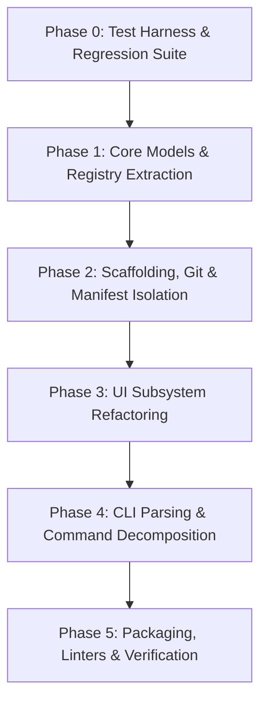

# Basecamp Codebase Modernization Plan

> **Audit Date:** October 19, 2026  
> **Target:** Basecamp 0.3.0 (`/home/usurper/Documents/Basecamp`)  
> **Status:** Implemented & Modernized  

---

## 1. Executive Summary & Diagnostic

Basecamp has evolved rapidly into a feature-rich scaffolding engine and Nix DevShell generator, supporting 20+ language stacks, polyglot document engines (Typst, LaTeX, Markdown under Folio), dynamic package bundle generation, interactive menus, and out-of-store/Frost integration.

However, rapid iteration has created significant architectural debt:
- **Monolithic "God Object" File:** Historical `cli.py` contained **2,129 lines** (84 KB) combining CLI parsing, built-in database definitions (roles, aliases, package bundles), configuration file parsing, template rendering, git mechanics, interactive prompt loops, and command dispatch.
- **High Cyclomatic Complexity:** Functions like `scaffold_assets` (~200 lines), `main` (~440 lines), and the positional argument heuristic resolver feature deeply nested branches with ad-hoc string handling and hardcoded special cases.
- **Embedded Static Assets:** Over 200 lines of Typst and LaTeX package snippets are hardcoded as raw multi-line Python strings inside `cli.py` rather than clean asset manifests or template files.
- **Zero Test Coverage:** The repository has 0 automated tests (`doCheck = false;` in `flake.nix`), causing regressions during refactoring and requiring manual testing for CLI edge cases.
- **Heuristic Argument Parsing:** A custom `while` loop parses `sys.argv` alongside a multi-step resolution cascade (trying alias mapping, colon syntax, preceding-role context, and standalone target matching), creating subtle precedence bugs.

The tool itself is architecturally sound in concept (pure standard library, zero external runtime dependencies, sub-30ms startup). This plan establishes a clean, modular structure that preserves 100% backward compatibility and sub-30ms startup while eliminating spaghetti code.

---

## 2. Technical Debt Matrix

| Category | Finding | Impact | Priority |
| :--- | :--- | :--- | :--- |
| **Modularity** | 2,129 lines concentrated in single monolithic `cli.py` | High cognitive load; hard to navigate, maintain, or extend. | **P0** |
| **Testing** | 0 unit or integration tests across the codebase | High regression risk on every edit; fear of touching resolution logic. | **P0** |
| **Data Separation** | 400 lines of `build_builtin_role_registry` & 200 lines of `TYPST`/`LATEX` package bundles hardcoded in `cli.py` | Code pollution; adding stacks or updating packages requires editing core CLI logic. | **P1** |
| **CLI & Parsing** | Bespoke `sys.argv` parsing loop + heuristic cascade | Brittle flag ordering; inconsistent handling of `--flag val` vs `--flag=val`; hard to document accurately. | **P1** |
| **Scaffolding Logic** | `scaffold_assets` handles file copying, string interpolation, special LaTeX ampersand escaping, and engine overrides in one loop | Difficult to test template generation in isolation without touching disk or mocking filesystem. | **P1** |
| **UI Coupling** | UI styling, raw terminal IO (`termios`/`tty`), and widget components coupled in `ui.py` (654 lines) | Difficult to test formatting separately from terminal escape sequence parsing. | **P2** |
| **Type Safety** | Pervasive `dict[str, Any]` and raw string tuples for option definitions | Lack of IDE autocomplete and static analysis validation. | **P2** |

---

## 3. Target Modular Architecture

```
basecamp/
├── __init__.py                  # Version and package export
├── __main__.py                  # Direct module execution hook
├── core/
│   ├── __init__.py
│   ├── models.py                # Dataclasses: Role, TargetSpec, PackageBundle, WorkspaceContext
│   ├── config.py                # User config parsing (~/.config/basecamp/roles.toml)
│   ├── registry.py              # Built-in role definitions, aliases, and channel resolvers
│   └── environment.py           # Flake template rendering, Nix channel URLs, Direnv hooks
├── scaffold/
│   ├── __init__.py
│   ├── engine.py                # Pure template rendering & file scaffolding
│   ├── git.py                   # .gitignore generation (Nix, Frost SSOT, roles) & git staging
│   └── manifests.py             # Modular Typst & LaTeX package manifest generators
├── ui/
│   ├── __init__.py              # Unified UI facade maintaining compatibility with existing ui.* calls
│   ├── ansi.py                  # ANSI colors, styles, badges, and panel rendering
│   ├── terminal.py              # Raw keypress capture (termios/tty/select) & line-fitting
│   ├── spinner.py               # Background braille spinner
│   └── menu.py                  # Single-select & multi-select interactive terminal menus
├── cli/
│   ├── __init__.py
│   ├── args.py                  # Robust argument parsing & option extraction
│   ├── resolver.py              # Deterministic role/target/alias resolution cascade
│   ├── commands/
│   │   ├── __init__.py
│   │   ├── init.py              # 'basecamp init' command handler
│   │   ├── new.py               # 'basecamp new' command handler
│   │   ├── shell.py             # 'basecamp shell' command handler
│   │   ├── project.py           # 'basecamp project' command handler
│   │   ├── packages.py          # 'basecamp packages' command handler
│   │   ├── list_cmd.py          # 'basecamp list' command handler
│   │   ├── info.py              # 'basecamp info' command handler
│   │   └── interactive.py       # 'basecamp interactive' menu flow
│   └── router.py                # Entrypoint router & error boundary
├── templates/                   # Static starter & project templates (existing structure)
└── flake.template               # Root flake.nix skeleton
```

### Module Responsibilities

1. **`basecamp.core.models`**: Typed dataclasses (`Role`, `TargetSpec`, `PackageBundle`, `ScaffoldResult`) with strict typing.
2. **`basecamp.core.registry`**: Pure data definitions for built-in roles (`rust`, `python`, `folio`, etc.), channel URLs, and default aliases.
3. **`basecamp.core.config`**: Robust parsing and schema validation of user-defined overrides in `~/.config/basecamp/roles.toml`.
4. **`basecamp.scaffold.engine`**: Pure scaffolding function taking source templates, target directory, variable mapping, and returning planned or written files.
5. **`basecamp.scaffold.git`**: Dedicated handler for Frost global ignores, Nix/direnv base rules, role-specific ignores, and safe `git add` staging.
6. **`basecamp.scaffold.manifests`**: Isolated Typst and LaTeX package bundle registries and generator functions.
7. **`basecamp.cli.resolver`**: Clean, unit-tested resolution logic for colon syntax (`folio:slides`), target flags (`-m slides`), role aliases, and positional fallbacks.
8. **`basecamp.cli.commands.*`**: Discrete command execution functions with unified return codes and error handling.

---

## 4. Phased Implementation Roadmap



### Phase 0: Test Harness & Regression Baseline (Safety First)
*Goal: Guarantee zero behavioral regressions before touching existing logic.*

1. **Test Infrastructure:**
   - Configure `pytest` in `pyproject.toml` under optional dependencies `[project.optional-dependencies] test = ["pytest"]`.
   - Add `pkgs.python3Packages.pytest` to `devShells.default` in `flake.nix`.
2. **Comprehensive Test Suite (`tests/`):**
   - `test_cli_args.py`: Validate flag parsing, help message, version output, and channel resolution.
   - `test_resolver.py`: Test role aliases (`py` -> `python`, `md` -> `folio:paper`, `beamer` -> `folio:latex-slides`), colon syntax (`folio:slides`), and positional targets.
   - `test_scaffold.py`: Test dry-run scaffolding for Python, Rust, Folio (Typst and LaTeX engines), checking file creation and template variable substitution.
   - `test_flake_gen.py`: Verify generated `flake.nix` and `.envrc` content against expected outputs.
   - `test_packages_manifest.py`: Test dynamic Typst and LaTeX manifest generation with custom and default selections.
   - `test_gitignore.py`: Verify deduplication and Frost ignore integration.

### Phase 1: Core Models & Data Registry Extraction
*Goal: Strip 500+ lines of static dictionaries out of `cli.py`.*

1. Create `basecamp/core/models.py`:
   - Define `Role`, `TargetSpec`, `PackageBundle`.
2. Create `basecamp/core/registry.py`:
   - Move `build_builtin_role_registry()` and `BUILTIN_ALIASES` out of `cli.py`.
   - Provide helper lookup functions: `get_role(name)`, `resolve_alias(name)`.
3. Create `basecamp/core/config.py`:
   - Migrate `load_user_config()` with graceful error handling and clear warnings on invalid TOML.
4. Create `basecamp/core/environment.py`:
   - Migrate `resolve_nixpkgs_url()` and `prepare_flake_env()`.

### Phase 2: Scaffolding, Git & Package Manifest Isolation
*Goal: Decouple disk operations, Git interactions, and template processing.*

1. Create `basecamp/scaffold/git.py`:
   - Migrate `get_git_author()`.
   - Migrate `stage_git_files()`.
   - Migrate `update_gitignore()`, preserving Frost SSOT rules and deduplication logic.
2. Create `basecamp/scaffold/manifests.py`:
   - Extract `TYPST_PACKAGE_BUNDLES` and `LATEX_PACKAGE_BUNDLES`.
   - Move `generate_packages_manifest()` and `configure_packages_interactive()`.
3. Create `basecamp/scaffold/engine.py`:
   - Refactor `scaffold_assets()` into clean sub-routines:
     - `collect_template_files(role, target, scope, asset_dirs)`
     - `render_template_content(raw_text, metadata, is_latex)`
     - `write_file_safe(dest, content, force, dry_run)`

### Phase 3: UI Subsystem Refactoring
*Goal: Separate terminal protocol primitives from UI components while maintaining 100% API compatibility.*

1. Create `basecamp/ui/ansi.py`:
   - Formatting methods (`bold`, `dim`, `cyan`, `green`, `badge`, `status`, `panel`, `error_panel`).
   - `strip_ansi()` utility.
2. Create `basecamp/ui/terminal.py`:
   - Terminal raw mode context manager (`termios`/`tty`).
   - Non-blocking key reader (`_read_key`).
   - Line fitting and column clamping (`_fit_line`).
3. Create `basecamp/ui/spinner.py`:
   - Threaded braille terminal spinner.
4. Create `basecamp/ui/menu.py`:
   - Width/height-aware `select()` and `multiselect()` menus with scroll indicators.
5. Create `basecamp/ui/__init__.py`:
   - Export singleton instance `ui` preserving full backward compatibility for `from basecamp.ui import ui`.

### Phase 4: CLI Parsing & Command Decomposition
*Goal: Replace the 440-line `main()` monster with single-purpose command handlers.*

1. Create `basecamp/cli/resolver.py`:
   - Pure function `resolve_invocation(unparsed_items, target_flag, roles_db, aliases)` returning `(command, list[RoleInvocation])`.
2. Create `basecamp/cli/commands/`:
   - `init.py`: Setup DevShell, project foundation, and starter files.
   - `new.py`: Scaffold starter leaf files in current directory.
   - `shell.py`: Generate only `flake.nix`, `.envrc`, and `.gitignore`.
   - `project.py`: Scaffold only root foundation files.
   - `packages.py`: Interactive package manifest generator.
   - `list_cmd.py`: Table panel listing all registered roles and categories.
   - `info.py`: Detailed role inspector.
   - `interactive.py`: High-level interactive command & stack questionnaire.
3. Create `basecamp/cli/router.py`:
   - Entry point parsing options, routing to handlers, catching `KeyboardInterrupt` cleanly.

### Phase 5: Packaging, Flake & Developer Experience
*Goal: Verify end-to-end functionality, formatting, and performance.*

1. Update `pyproject.toml`:
   - Ensure `packages = ["basecamp", "basecamp.core", "basecamp.scaffold", "basecamp.ui", "basecamp.cli", "basecamp.cli.commands"]` or automatic package discovery finds all subpackages.
   - Verify `package-data` includes `flake.template` and `templates/**/*`.
2. Update `flake.nix`:
   - Enable `doCheck = true;` with `checkPhase = "pytest";`.
   - Update `postFixup` wrapping if necessary.
3. Validate:
   - Run complete `pytest` suite.
   - Verify startup benchmark: `python3 -c "import basecamp; import basecamp.cli"` completes in < 30ms.
   - Verify `nix flake check` passes.

---

## 5. Non-Negotiables & Invariants

1. **Zero External Runtime Dependencies:** Basecamp must rely strictly on Python's standard library (`sys`, `os`, `pathlib`, `shutil`, `subprocess`, `tomllib`, `dataclasses`, `termios`, `tty`, `select`, `threading`). No `click`, `rich`, `textual`, or external dependencies at runtime.
2. **Strict CLI Compatibility:** All existing commands, flags, short options, role names, aliases (`py`, `rs`, `mv`, `md:slides`, `typ:paper`), and `--dry-run` behavior must function identically.
3. **Sub-30ms Cold Start:** Module imports must remain lazy or lightweight; no heavy import chains during standard CLI execution.
4. **Frost Environment Awareness:** Must strictly preserve the `~/.config/frost/global_ignores` SSOT integration in `scaffold/git.py`.
5. **Overwrite Safety:** Confirmation prompts for existing files (`flake.nix`, `packages.typ`, etc.) must remain active in interactive TTY mode and strictly enforced with `--force` in non-interactive environments.
